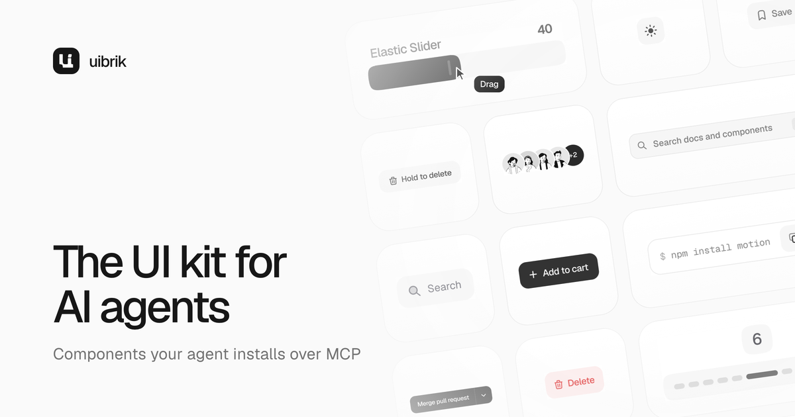
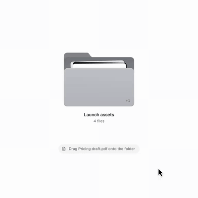
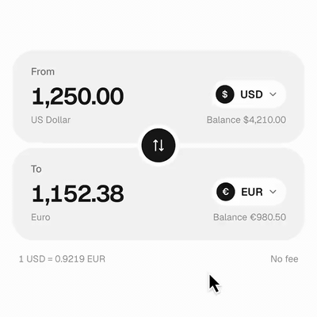
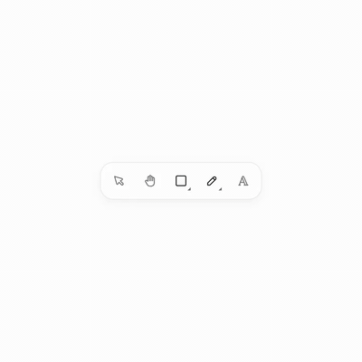

<a href="https://uibrik.com"></a>

<h1 align="center">uibrik</h1>

<p align="center">
  <b>137 free, animated React components.</b><br>
  Built with Tailwind CSS v4 and Motion. Install with the shadcn CLI, or let your AI agent do it over MCP.
</p>

<p align="center">
  
  
  
  
  
</p>

<p align="center">
  <a href="https://uibrik.com/components"><b>Browse live demos</b></a> ·
  <a href="https://uibrik.com/docs">Docs</a> ·
  <a href="https://uibrik.com/docs/mcp">MCP server</a> ·
  <a href="https://uibrik.com/#pricing">Pro</a>
</p>

<table>
  <tr>
    <td align="center" width="33%"><a href="https://uibrik.com/components/folder-peek"><picture><source media="(prefers-color-scheme: dark)" srcset=".github/assets/folder-peek-dark.gif"></picture></a><br><b>Folder Peek</b></td>
    <td align="center" width="33%"><a href="https://uibrik.com/components/swap-fields"><picture><source media="(prefers-color-scheme: dark)" srcset=".github/assets/swap-fields-dark.gif"></picture></a><br><b>Swap Fields</b></td>
    <td align="center" width="33%"><a href="https://uibrik.com/components/fold-toolbar"><picture><source media="(prefers-color-scheme: dark)" srcset=".github/assets/fold-toolbar-dark.gif"></picture></a><br><b>Fold Toolbar</b></td>
  </tr>
</table>

## Why uibrik

- **Motion that feels right.** Springs, staggered reveals and gestures, tuned by hand, with `prefers-reduced-motion` respected.
- **Accessible.** Real buttons and inputs, keyboard support and ARIA where it matters.
- **Light and dark.** Every component reads shadcn's theme tokens, so it matches your app.
- **Yours to edit.** You get the source, not a package. Change anything.
- **Agent-ready.** An MCP server lets Claude, Cursor or VS Code search, preview and install components for you.

## Install

Each component installs with the shadcn CLI, which also adds its dependencies and any CSS it needs:

```bash
npx shadcn@latest add https://uibrik.com/r/<component>.json
```

For example:

```bash
npx shadcn@latest add https://uibrik.com/r/accordion.json
```

Or install straight from this repo:

```bash
npx shadcn@latest add Malay146/uibrik/accordion
```

Files land in `components/uibrik/`. You can also copy a file from [`components/`](./components) by hand. Components import `cn` from `@/lib/utils` ([included here](./lib/utils.ts)), and some need extra theme CSS that only the CLI adds, so the CLI is the easier path.

Requirements: React 19 and Tailwind CSS v4.

### With an AI agent

Connect the MCP server and ask for what you need, like "add a pricing toggle".

```bash
claude mcp add --transport http uibrik https://uibrik.com/mcp
```

Setup for Cursor, VS Code and others is in the [MCP docs](https://uibrik.com/docs/mcp) and the [uibrik-mcp](https://github.com/Malay146/uibrik-mcp) repo, which has ready-to-copy client configs.

## Components

Click any component to open its live demo, where you can tweak its props and copy the code.

### Entrances

<table>
  <tr>
    <td align="center" valign="top" width="33%"><a href="https://uibrik.com/components/blur-reveal"><picture><source media="(prefers-color-scheme: dark)" srcset="https://uibrik.com/registry/blur-reveal/thumb-dark-sm.webp"></picture><br><b>Blur Reveal</b></a></td>
    <td align="center" valign="top" width="33%"><a href="https://uibrik.com/components/fade-left-to-right"><picture><source media="(prefers-color-scheme: dark)" srcset="https://uibrik.com/registry/fade-left-to-right/thumb-dark-sm.webp"></picture><br><b>Fade In Left to Right</b></a></td>
    <td align="center" valign="top" width="33%"><a href="https://uibrik.com/components/falling-letters"><picture><source media="(prefers-color-scheme: dark)" srcset="https://uibrik.com/registry/falling-letters/thumb-dark-sm.webp"></picture><br><b>Falling Letters</b></a></td>
  </tr>
  <tr>
    <td align="center" valign="top" width="33%"><a href="https://uibrik.com/components/highlighter"><picture><source media="(prefers-color-scheme: dark)" srcset="https://uibrik.com/registry/highlighter/thumb-dark-sm.webp"></picture><br><b>Highlighter</b></a></td>
    <td align="center" valign="top" width="33%"><a href="https://uibrik.com/components/line-rise"><picture><source media="(prefers-color-scheme: dark)" srcset="https://uibrik.com/registry/line-rise/thumb-dark-sm.webp"></picture><br><b>Line-by-line Rise</b></a></td>
    <td align="center" valign="top" width="33%"><a href="https://uibrik.com/components/outline-fill"><picture><source media="(prefers-color-scheme: dark)" srcset="https://uibrik.com/registry/outline-fill/thumb-dark-sm.webp"></picture><br><b>Outline then Fill</b></a></td>
  </tr>
  <tr>
    <td align="center" valign="top" width="33%"><a href="https://uibrik.com/components/plucked-curve"><picture><source media="(prefers-color-scheme: dark)" srcset="https://uibrik.com/registry/plucked-curve/thumb-dark-sm.webp"></picture><br><b>Plucked Curve</b></a></td>
    <td align="center" valign="top" width="33%"><a href="https://uibrik.com/components/ripple-to-still"><picture><source media="(prefers-color-scheme: dark)" srcset="https://uibrik.com/registry/ripple-to-still/thumb-dark-sm.webp"></picture><br><b>Ripple to Still</b></a></td>
    <td align="center" valign="top" width="33%"><a href="https://uibrik.com/components/scramble-text"><picture><source media="(prefers-color-scheme: dark)" srcset="https://uibrik.com/registry/scramble-text/thumb-dark-sm.webp"></picture><br><b>Scramble Text</b></a></td>
  </tr>
  <tr>
    <td align="center" valign="top" width="33%"><a href="https://uibrik.com/components/scroll-highlight"><picture><source media="(prefers-color-scheme: dark)" srcset="https://uibrik.com/registry/scroll-highlight/thumb-dark-sm.webp"></picture><br><b>Scroll to Highlight</b></a></td>
    <td align="center" valign="top" width="33%"><a href="https://uibrik.com/components/tracking-in"><picture><source media="(prefers-color-scheme: dark)" srcset="https://uibrik.com/registry/tracking-in/thumb-dark-sm.webp"></picture><br><b>Tracking In</b></a></td>
    <td align="center" valign="top" width="33%"><a href="https://uibrik.com/components/typewriter"><picture><source media="(prefers-color-scheme: dark)" srcset="https://uibrik.com/registry/typewriter/thumb-dark-sm.webp"></picture><br><b>Typewriter</b></a></td>
  </tr>
</table>

### Transitions

<table>
  <tr>
    <td align="center" valign="top" width="33%"><a href="https://uibrik.com/components/anagram-shuffle"><picture><source media="(prefers-color-scheme: dark)" srcset="https://uibrik.com/registry/anagram-shuffle/thumb-dark-sm.webp"></picture><br><b>Anagram Shuffle</b></a></td>
    <td align="center" valign="top" width="33%"><a href="https://uibrik.com/components/particle-scatter"><picture><source media="(prefers-color-scheme: dark)" srcset="https://uibrik.com/registry/particle-scatter/thumb-dark-sm.webp"></picture><br><b>Particle Scatter</b></a></td>
    <td align="center" valign="top" width="33%"><a href="https://uibrik.com/components/redact-reveal"><picture><source media="(prefers-color-scheme: dark)" srcset="https://uibrik.com/registry/redact-reveal/thumb-dark-sm.webp"></picture><br><b>Redact and Reveal</b></a></td>
  </tr>
  <tr>
    <td align="center" valign="top" width="33%"><a href="https://uibrik.com/components/rolling-word"><picture><source media="(prefers-color-scheme: dark)" srcset="https://uibrik.com/registry/rolling-word/thumb-dark-sm.webp"></picture><br><b>Rolling Word</b></a></td>
    <td align="center" valign="top" width="33%"><a href="https://uibrik.com/components/scatter-text"><picture><source media="(prefers-color-scheme: dark)" srcset="https://uibrik.com/registry/scatter-text/thumb-dark-sm.webp"></picture><br><b>Scatter Text</b></a></td>
    <td align="center" valign="top" width="33%"><a href="https://uibrik.com/components/scramble-to-word"><picture><source media="(prefers-color-scheme: dark)" srcset="https://uibrik.com/registry/scramble-to-word/thumb-dark-sm.webp"></picture><br><b>Scramble to Word</b></a></td>
  </tr>
  <tr>
    <td align="center" valign="top" width="33%"><a href="https://uibrik.com/components/slot-letters"><picture><source media="(prefers-color-scheme: dark)" srcset="https://uibrik.com/registry/slot-letters/thumb-dark-sm.webp"></picture><br><b>Slot-machine Letters</b></a></td>
    <td align="center" valign="top" width="33%"><a href="https://uibrik.com/components/status-stamp"><picture><source media="(prefers-color-scheme: dark)" srcset="https://uibrik.com/registry/status-stamp/thumb-dark-sm.webp"></picture><br><b>Status Stamp</b></a></td>
    <td align="center" valign="top" width="33%"><a href="https://uibrik.com/components/zoom-past"><picture><source media="(prefers-color-scheme: dark)" srcset="https://uibrik.com/registry/zoom-past/thumb-dark-sm.webp"></picture><br><b>Zoom Past</b></a></td>
  </tr>
</table>

### Interactive

<table>
  <tr>
    <td align="center" valign="top" width="33%"><a href="https://uibrik.com/components/draggable-letters"><picture><source media="(prefers-color-scheme: dark)" srcset="https://uibrik.com/registry/draggable-letters/thumb-dark-sm.webp"></picture><br><b>Draggable Letters</b></a></td>
    <td align="center" valign="top" width="33%"><a href="https://uibrik.com/components/hover-weight"><picture><source media="(prefers-color-scheme: dark)" srcset="https://uibrik.com/registry/hover-weight/thumb-dark-sm.webp"></picture><br><b>Hover Weight</b></a></td>
    <td align="center" valign="top" width="33%"><a href="https://uibrik.com/components/lean-scramble"><picture><source media="(prefers-color-scheme: dark)" srcset="https://uibrik.com/registry/lean-scramble/thumb-dark-sm.webp"></picture><br><b>Lean and Scramble</b></a></td>
  </tr>
  <tr>
    <td align="center" valign="top" width="33%"><a href="https://uibrik.com/components/pull-to-cursor"><picture><source media="(prefers-color-scheme: dark)" srcset="https://uibrik.com/registry/pull-to-cursor/thumb-dark-sm.webp"></picture><br><b>Pull Toward Cursor</b></a></td>
    <td align="center" valign="top" width="33%"><a href="https://uibrik.com/components/rust-text"><picture><source media="(prefers-color-scheme: dark)" srcset="https://uibrik.com/registry/rust-text/thumb-dark-sm.webp"></picture><br><b>Rust Text</b></a></td>
  </tr>
</table>

### Buttons

<table>
  <tr>
    <td align="center" valign="top" width="33%"><a href="https://uibrik.com/components/announcement-pill"><picture><source media="(prefers-color-scheme: dark)" srcset="https://uibrik.com/registry/announcement-pill/thumb-dark-sm.webp"></picture><br><b>Announcement Pill</b></a></td>
    <td align="center" valign="top" width="33%"><a href="https://uibrik.com/components/balloon-button"><picture><source media="(prefers-color-scheme: dark)" srcset="https://uibrik.com/registry/balloon-button/thumb-dark-sm.webp"></picture><br><b>Balloon Button</b></a></td>
    <td align="center" valign="top" width="33%"><a href="https://uibrik.com/components/bookmark-button"><picture><source media="(prefers-color-scheme: dark)" srcset="https://uibrik.com/registry/bookmark-button/thumb-dark-sm.webp"></picture><br><b>Bookmark Button</b></a></td>
  </tr>
  <tr>
    <td align="center" valign="top" width="33%"><a href="https://uibrik.com/components/chain-copy"><picture><source media="(prefers-color-scheme: dark)" srcset="https://uibrik.com/registry/chain-copy/thumb-dark-sm.webp"></picture><br><b>Chain Copy</b></a></td>
    <td align="center" valign="top" width="33%"><a href="https://uibrik.com/components/copy-button"><picture><source media="(prefers-color-scheme: dark)" srcset="https://uibrik.com/registry/copy-button/thumb-dark-sm.webp"></picture><br><b>Copy Button</b></a></td>
    <td align="center" valign="top" width="33%"><a href="https://uibrik.com/components/expand-button"><picture><source media="(prefers-color-scheme: dark)" srcset="https://uibrik.com/registry/expand-button/thumb-dark-sm.webp"></picture><br><b>Expand Button</b></a></td>
  </tr>
  <tr>
    <td align="center" valign="top" width="33%"><a href="https://uibrik.com/components/hold-to-confirm"><picture><source media="(prefers-color-scheme: dark)" srcset="https://uibrik.com/registry/hold-to-confirm/thumb-dark-sm.webp"></picture><br><b>Hold to Confirm</b></a></td>
    <td align="center" valign="top" width="33%"><a href="https://uibrik.com/components/inline-confirm"><picture><source media="(prefers-color-scheme: dark)" srcset="https://uibrik.com/registry/inline-confirm/thumb-dark-sm.webp"></picture><br><b>Inline Confirm</b></a></td>
    <td align="center" valign="top" width="33%"><a href="https://uibrik.com/components/share-menu"><picture><source media="(prefers-color-scheme: dark)" srcset="https://uibrik.com/registry/share-menu/thumb-dark-sm.webp"></picture><br><b>Share Menu</b></a></td>
  </tr>
  <tr>
    <td align="center" valign="top" width="33%"><a href="https://uibrik.com/components/soft-button"><picture><source media="(prefers-color-scheme: dark)" srcset="https://uibrik.com/registry/soft-button/thumb-dark-sm.webp"></picture><br><b>Soft Button</b></a></td>
    <td align="center" valign="top" width="33%"><a href="https://uibrik.com/components/split-button"><picture><source media="(prefers-color-scheme: dark)" srcset="https://uibrik.com/registry/split-button/thumb-dark-sm.webp"></picture><br><b>Split Button</b></a></td>
    <td align="center" valign="top" width="33%"><a href="https://uibrik.com/components/stepper-button"><picture><source media="(prefers-color-scheme: dark)" srcset="https://uibrik.com/registry/stepper-button/thumb-dark-sm.webp"></picture><br><b>Stepper Button</b></a></td>
  </tr>
  <tr>
    <td align="center" valign="top" width="33%"><a href="https://uibrik.com/components/tactile-toggle"><picture><source media="(prefers-color-scheme: dark)" srcset="https://uibrik.com/registry/tactile-toggle/thumb-dark-sm.webp"></picture><br><b>Tactile Toggle</b></a></td>
    <td align="center" valign="top" width="33%"><a href="https://uibrik.com/components/theme-switch"><picture><source media="(prefers-color-scheme: dark)" srcset="https://uibrik.com/registry/theme-switch/thumb-dark-sm.webp"></picture><br><b>Theme Switch</b></a></td>
  </tr>
</table>

### State Changes

<table>
  <tr>
    <td align="center" valign="top" width="33%"><a href="https://uibrik.com/components/disabled-reason"><picture><source media="(prefers-color-scheme: dark)" srcset="https://uibrik.com/registry/disabled-reason/thumb-dark-sm.webp"></picture><br><b>Disabled Reason</b></a></td>
    <td align="center" valign="top" width="33%"><a href="https://uibrik.com/components/download-button"><picture><source media="(prefers-color-scheme: dark)" srcset="https://uibrik.com/registry/download-button/thumb-dark-sm.webp"></picture><br><b>Download Button</b></a></td>
    <td align="center" valign="top" width="33%"><a href="https://uibrik.com/components/follow-button"><picture><source media="(prefers-color-scheme: dark)" srcset="https://uibrik.com/registry/follow-button/thumb-dark-sm.webp"></picture><br><b>Follow Button</b></a></td>
  </tr>
  <tr>
    <td align="center" valign="top" width="33%"><a href="https://uibrik.com/components/live-kbd"><picture><source media="(prefers-color-scheme: dark)" srcset="https://uibrik.com/registry/live-kbd/thumb-dark-sm.webp"></picture><br><b>Live Kbd</b></a></td>
    <td align="center" valign="top" width="33%"><a href="https://uibrik.com/components/mute-toggle"><picture><source media="(prefers-color-scheme: dark)" srcset="https://uibrik.com/registry/mute-toggle/thumb-dark-sm.webp"></picture><br><b>Mute Toggle</b></a></td>
    <td align="center" valign="top" width="33%"><a href="https://uibrik.com/components/notification-bell"><picture><source media="(prefers-color-scheme: dark)" srcset="https://uibrik.com/registry/notification-bell/thumb-dark-sm.webp"></picture><br><b>Notification Bell</b></a></td>
  </tr>
  <tr>
    <td align="center" valign="top" width="33%"><a href="https://uibrik.com/components/password-peek"><picture><source media="(prefers-color-scheme: dark)" srcset="https://uibrik.com/registry/password-peek/thumb-dark-sm.webp"></picture><br><b>Password Peek</b></a></td>
    <td align="center" valign="top" width="33%"><a href="https://uibrik.com/components/read-receipts"><picture><source media="(prefers-color-scheme: dark)" srcset="https://uibrik.com/registry/read-receipts/thumb-dark-sm.webp"></picture><br><b>Read Receipts</b></a></td>
    <td align="center" valign="top" width="33%"><a href="https://uibrik.com/components/sync-button"><picture><source media="(prefers-color-scheme: dark)" srcset="https://uibrik.com/registry/sync-button/thumb-dark-sm.webp"></picture><br><b>Sync Button</b></a></td>
  </tr>
  <tr>
    <td align="center" valign="top" width="33%"><a href="https://uibrik.com/components/typing-dots"><picture><source media="(prefers-color-scheme: dark)" srcset="https://uibrik.com/registry/typing-dots/thumb-dark-sm.webp"></picture><br><b>Typing Dots</b></a></td>
  </tr>
</table>

### Inputs

<table>
  <tr>
    <td align="center" valign="top" width="33%"><a href="https://uibrik.com/components/amount-pad"><picture><source media="(prefers-color-scheme: dark)" srcset="https://uibrik.com/registry/amount-pad/thumb-dark-sm.webp"></picture><br><b>Amount Pad</b></a></td>
    <td align="center" valign="top" width="33%"><a href="https://uibrik.com/components/checkbox"><picture><source media="(prefers-color-scheme: dark)" srcset="https://uibrik.com/registry/checkbox/thumb-dark-sm.webp"></picture><br><b>Checkbox</b></a></td>
    <td align="center" valign="top" width="33%"><a href="https://uibrik.com/components/elastic-slider"><picture><source media="(prefers-color-scheme: dark)" srcset="https://uibrik.com/registry/elastic-slider/thumb-dark-sm.webp"></picture><br><b>Elastic Slider</b></a></td>
  </tr>
  <tr>
    <td align="center" valign="top" width="33%"><a href="https://uibrik.com/components/inline-edit"><picture><source media="(prefers-color-scheme: dark)" srcset="https://uibrik.com/registry/inline-edit/thumb-dark-sm.webp"></picture><br><b>Inline Edit</b></a></td>
    <td align="center" valign="top" width="33%"><a href="https://uibrik.com/components/radio-group"><picture><source media="(prefers-color-scheme: dark)" srcset="https://uibrik.com/registry/radio-group/thumb-dark-sm.webp"></picture><br><b>Radio Group</b></a></td>
    <td align="center" valign="top" width="33%"><a href="https://uibrik.com/components/reject-drop-input"><picture><source media="(prefers-color-scheme: dark)" srcset="https://uibrik.com/registry/reject-drop-input/thumb-dark-sm.webp"></picture><br><b>Reject Drop Input</b></a></td>
  </tr>
  <tr>
    <td align="center" valign="top" width="33%"><a href="https://uibrik.com/components/segmented-control"><picture><source media="(prefers-color-scheme: dark)" srcset="https://uibrik.com/registry/segmented-control/thumb-dark-sm.webp"></picture><br><b>Segmented Control</b></a></td>
    <td align="center" valign="top" width="33%"><a href="https://uibrik.com/components/spill-textarea"><picture><source media="(prefers-color-scheme: dark)" srcset="https://uibrik.com/registry/spill-textarea/thumb-dark-sm.webp"></picture><br><b>Spill Textarea</b></a></td>
    <td align="center" valign="top" width="33%"><a href="https://uibrik.com/components/swap-fields"><picture><source media="(prefers-color-scheme: dark)" srcset="https://uibrik.com/registry/swap-fields/thumb-dark-sm.webp"></picture><br><b>Swap Fields</b></a></td>
  </tr>
  <tr>
    <td align="center" valign="top" width="33%"><a href="https://uibrik.com/components/tactile-toggles"><picture><source media="(prefers-color-scheme: dark)" srcset="https://uibrik.com/registry/tactile-toggles/thumb-dark-sm.webp"></picture><br><b>Tactile Toggles</b></a></td>
    <td align="center" valign="top" width="33%"><a href="https://uibrik.com/components/tag-input"><picture><source media="(prefers-color-scheme: dark)" srcset="https://uibrik.com/registry/tag-input/thumb-dark-sm.webp"></picture><br><b>Tag Input</b></a></td>
    <td align="center" valign="top" width="33%"><a href="https://uibrik.com/components/waitlist-input"><picture><source media="(prefers-color-scheme: dark)" srcset="https://uibrik.com/registry/waitlist-input/thumb-dark-sm.webp"></picture><br><b>Waitlist Input</b></a></td>
  </tr>
</table>

### Navigation

<table>
  <tr>
    <td align="center" valign="top" width="33%"><a href="https://uibrik.com/components/collapsing-breadcrumb"><picture><source media="(prefers-color-scheme: dark)" srcset="https://uibrik.com/registry/collapsing-breadcrumb/thumb-dark-sm.webp"></picture><br><b>Collapsing Breadcrumb</b></a></td>
    <td align="center" valign="top" width="33%"><a href="https://uibrik.com/components/fold-toolbar"><picture><source media="(prefers-color-scheme: dark)" srcset="https://uibrik.com/registry/fold-toolbar/thumb-dark-sm.webp"></picture><br><b>Fold Toolbar</b></a></td>
    <td align="center" valign="top" width="33%"><a href="https://uibrik.com/components/hamburger-sheet"><picture><source media="(prefers-color-scheme: dark)" srcset="https://uibrik.com/registry/hamburger-sheet/thumb-dark-sm.webp"></picture><br><b>Hamburger Sheet</b></a></td>
  </tr>
  <tr>
    <td align="center" valign="top" width="33%"><a href="https://uibrik.com/components/large-title-header"><picture><source media="(prefers-color-scheme: dark)" srcset="https://uibrik.com/registry/large-title-header/thumb-dark-sm.webp"></picture><br><b>Large Title Header</b></a></td>
    <td align="center" valign="top" width="33%"><a href="https://uibrik.com/components/on-this-page"><picture><source media="(prefers-color-scheme: dark)" srcset="https://uibrik.com/registry/on-this-page/thumb-dark-sm.webp"></picture><br><b>On This Page</b></a></td>
    <td align="center" valign="top" width="33%"><a href="https://uibrik.com/components/page-indicator"><picture><source media="(prefers-color-scheme: dark)" srcset="https://uibrik.com/registry/page-indicator/thumb-dark-sm.webp"></picture><br><b>Page Indicator</b></a></td>
  </tr>
  <tr>
    <td align="center" valign="top" width="33%"><a href="https://uibrik.com/components/pagination"><picture><source media="(prefers-color-scheme: dark)" srcset="https://uibrik.com/registry/pagination/thumb-dark-sm.webp"></picture><br><b>Pagination</b></a></td>
    <td align="center" valign="top" width="33%"><a href="https://uibrik.com/components/progress-dots"><picture><source media="(prefers-color-scheme: dark)" srcset="https://uibrik.com/registry/progress-dots/thumb-dark-sm.webp"></picture><br><b>Progress Dots</b></a></td>
    <td align="center" valign="top" width="33%"><a href="https://uibrik.com/components/section-pill"><picture><source media="(prefers-color-scheme: dark)" srcset="https://uibrik.com/registry/section-pill/thumb-dark-sm.webp"></picture><br><b>Section Pill</b></a></td>
  </tr>
  <tr>
    <td align="center" valign="top" width="33%"><a href="https://uibrik.com/components/tick-nav"><picture><source media="(prefers-color-scheme: dark)" srcset="https://uibrik.com/registry/tick-nav/thumb-dark-sm.webp"></picture><br><b>Tick Nav</b></a></td>
  </tr>
</table>

### Overlays

<table>
  <tr>
    <td align="center" valign="top" width="33%"><a href="https://uibrik.com/components/command-menu"><picture><source media="(prefers-color-scheme: dark)" srcset="https://uibrik.com/registry/command-menu/thumb-dark-sm.webp"></picture><br><b>Command Menu</b></a></td>
    <td align="center" valign="top" width="33%"><a href="https://uibrik.com/components/context-menu"><picture><source media="(prefers-color-scheme: dark)" srcset="https://uibrik.com/registry/context-menu/thumb-dark-sm.webp"></picture><br><b>Context Menu</b></a></td>
    <td align="center" valign="top" width="33%"><a href="https://uibrik.com/components/cookie-consent"><picture><source media="(prefers-color-scheme: dark)" srcset="https://uibrik.com/registry/cookie-consent/thumb-dark-sm.webp"></picture><br><b>Cookie Consent</b></a></td>
  </tr>
  <tr>
    <td align="center" valign="top" width="33%"><a href="https://uibrik.com/components/dialog"><picture><source media="(prefers-color-scheme: dark)" srcset="https://uibrik.com/registry/dialog/thumb-dark-sm.webp"></picture><br><b>Dialog</b></a></td>
    <td align="center" valign="top" width="33%"><a href="https://uibrik.com/components/dropdown-menu"><picture><source media="(prefers-color-scheme: dark)" srcset="https://uibrik.com/registry/dropdown-menu/thumb-dark-sm.webp"></picture><br><b>Dropdown Menu</b></a></td>
    <td align="center" valign="top" width="33%"><a href="https://uibrik.com/components/hover-card"><picture><source media="(prefers-color-scheme: dark)" srcset="https://uibrik.com/registry/hover-card/thumb-dark-sm.webp"></picture><br><b>Hover Card</b></a></td>
  </tr>
  <tr>
    <td align="center" valign="top" width="33%"><a href="https://uibrik.com/components/morphing-popover"><picture><source media="(prefers-color-scheme: dark)" srcset="https://uibrik.com/registry/morphing-popover/thumb-dark-sm.webp"></picture><br><b>Morphing Popover</b></a></td>
    <td align="center" valign="top" width="33%"><a href="https://uibrik.com/components/notification-stack"><picture><source media="(prefers-color-scheme: dark)" srcset="https://uibrik.com/registry/notification-stack/thumb-dark-sm.webp"></picture><br><b>Notification Stack</b></a></td>
    <td align="center" valign="top" width="33%"><a href="https://uibrik.com/components/popover"><picture><source media="(prefers-color-scheme: dark)" srcset="https://uibrik.com/registry/popover/thumb-dark-sm.webp"></picture><br><b>Popover</b></a></td>
  </tr>
  <tr>
    <td align="center" valign="top" width="33%"><a href="https://uibrik.com/components/toast"><picture><source media="(prefers-color-scheme: dark)" srcset="https://uibrik.com/registry/toast/thumb-dark-sm.webp"></picture><br><b>Toast</b></a></td>
    <td align="center" valign="top" width="33%"><a href="https://uibrik.com/components/tooltip"><picture><source media="(prefers-color-scheme: dark)" srcset="https://uibrik.com/registry/tooltip/thumb-dark-sm.webp"></picture><br><b>Tooltip</b></a></td>
  </tr>
</table>

### Feedback

<table>
  <tr>
    <td align="center" valign="top" width="33%"><a href="https://uibrik.com/components/effort-dial"><picture><source media="(prefers-color-scheme: dark)" srcset="https://uibrik.com/registry/effort-dial/thumb-dark-sm.webp"></picture><br><b>Effort Dial</b></a></td>
    <td align="center" valign="top" width="33%"><a href="https://uibrik.com/components/nps-strip"><picture><source media="(prefers-color-scheme: dark)" srcset="https://uibrik.com/registry/nps-strip/thumb-dark-sm.webp"></picture><br><b>NPS Strip</b></a></td>
  </tr>
</table>

### Loaders & Progress

<table>
  <tr>
    <td align="center" valign="top" width="33%"><a href="https://uibrik.com/components/liquid-progress"><picture><source media="(prefers-color-scheme: dark)" srcset="https://uibrik.com/registry/liquid-progress/thumb-dark-sm.webp"></picture><br><b>Liquid Progress</b></a></td>
    <td align="center" valign="top" width="33%"><a href="https://uibrik.com/components/loading-shimmer"><picture><source media="(prefers-color-scheme: dark)" srcset="https://uibrik.com/registry/loading-shimmer/thumb-dark-sm.webp"></picture><br><b>Loading Shimmer</b></a></td>
    <td align="center" valign="top" width="33%"><a href="https://uibrik.com/components/progress"><picture><source media="(prefers-color-scheme: dark)" srcset="https://uibrik.com/registry/progress/thumb-dark-sm.webp"></picture><br><b>Progress</b></a></td>
  </tr>
  <tr>
    <td align="center" valign="top" width="33%"><a href="https://uibrik.com/components/send"><picture><source media="(prefers-color-scheme: dark)" srcset="https://uibrik.com/registry/send/thumb-dark-sm.webp"></picture><br><b>Send</b></a></td>
    <td align="center" valign="top" width="33%"><a href="https://uibrik.com/components/skeleton"><picture><source media="(prefers-color-scheme: dark)" srcset="https://uibrik.com/registry/skeleton/thumb-dark-sm.webp"></picture><br><b>Skeleton</b></a></td>
    <td align="center" valign="top" width="33%"><a href="https://uibrik.com/components/spinner"><picture><source media="(prefers-color-scheme: dark)" srcset="https://uibrik.com/registry/spinner/thumb-dark-sm.webp"></picture><br><b>Spinner</b></a></td>
  </tr>
</table>

### AI

<table>
  <tr>
    <td align="center" valign="top" width="33%"><a href="https://uibrik.com/components/prompt-input"><picture><source media="(prefers-color-scheme: dark)" srcset="https://uibrik.com/registry/prompt-input/thumb-dark-sm.webp"></picture><br><b>Prompt Input</b></a></td>
  </tr>
</table>

### Data Display

<table>
  <tr>
    <td align="center" valign="top" width="33%"><a href="https://uibrik.com/components/code-block"><picture><source media="(prefers-color-scheme: dark)" srcset="https://uibrik.com/registry/code-block/thumb-dark-sm.webp"></picture><br><b>Code Block</b></a></td>
    <td align="center" valign="top" width="33%"><a href="https://uibrik.com/components/strike-todos"><picture><source media="(prefers-color-scheme: dark)" srcset="https://uibrik.com/registry/strike-todos/thumb-dark-sm.webp"></picture><br><b>Strike Todos</b></a></td>
    <td align="center" valign="top" width="33%"><a href="https://uibrik.com/components/tree-view"><picture><source media="(prefers-color-scheme: dark)" srcset="https://uibrik.com/registry/tree-view/thumb-dark-sm.webp"></picture><br><b>Tree View</b></a></td>
  </tr>
</table>

### Avatars & Badges

<table>
  <tr>
    <td align="center" valign="top" width="33%"><a href="https://uibrik.com/components/avatar-stack"><picture><source media="(prefers-color-scheme: dark)" srcset="https://uibrik.com/registry/avatar-stack/thumb-dark-sm.webp"></picture><br><b>Avatar Stack</b></a></td>
    <td align="center" valign="top" width="33%"><a href="https://uibrik.com/components/light-badge"><picture><source media="(prefers-color-scheme: dark)" srcset="https://uibrik.com/registry/light-badge/thumb-dark-sm.webp"></picture><br><b>Light Badge</b></a></td>
    <td align="center" valign="top" width="33%"><a href="https://uibrik.com/components/social-avatar"><picture><source media="(prefers-color-scheme: dark)" srcset="https://uibrik.com/registry/social-avatar/thumb-dark-sm.webp"></picture><br><b>Social Avatar</b></a></td>
  </tr>
  <tr>
    <td align="center" valign="top" width="33%"><a href="https://uibrik.com/components/status-badge"><picture><source media="(prefers-color-scheme: dark)" srcset="https://uibrik.com/registry/status-badge/thumb-dark-sm.webp"></picture><br><b>Status Badge</b></a></td>
    <td align="center" valign="top" width="33%"><a href="https://uibrik.com/components/story-ring"><picture><source media="(prefers-color-scheme: dark)" srcset="https://uibrik.com/registry/story-ring/thumb-dark-sm.webp"></picture><br><b>Story Ring</b></a></td>
    <td align="center" valign="top" width="33%"><a href="https://uibrik.com/components/tech-stack"><picture><source media="(prefers-color-scheme: dark)" srcset="https://uibrik.com/registry/tech-stack/thumb-dark-sm.webp"></picture><br><b>Tech Stack</b></a></td>
  </tr>
  <tr>
    <td align="center" valign="top" width="33%"><a href="https://uibrik.com/components/verified-badge"><picture><source media="(prefers-color-scheme: dark)" srcset="https://uibrik.com/registry/verified-badge/thumb-dark-sm.webp"></picture><br><b>Verified Badge</b></a></td>
  </tr>
</table>

### Layout

<table>
  <tr>
    <td align="center" valign="top" width="33%"><a href="https://uibrik.com/components/filter-grid"><picture><source media="(prefers-color-scheme: dark)" srcset="https://uibrik.com/registry/filter-grid/thumb-dark-sm.webp"></picture><br><b>Filter Grid</b></a></td>
    <td align="center" valign="top" width="33%"><a href="https://uibrik.com/components/fold-tabs"><picture><source media="(prefers-color-scheme: dark)" srcset="https://uibrik.com/registry/fold-tabs/thumb-dark-sm.webp"></picture><br><b>Fold Tabs</b></a></td>
    <td align="center" valign="top" width="33%"><a href="https://uibrik.com/components/jiggle-grid"><picture><source media="(prefers-color-scheme: dark)" srcset="https://uibrik.com/registry/jiggle-grid/thumb-dark-sm.webp"></picture><br><b>Jiggle Grid</b></a></td>
  </tr>
  <tr>
    <td align="center" valign="top" width="33%"><a href="https://uibrik.com/components/split-panes"><picture><source media="(prefers-color-scheme: dark)" srcset="https://uibrik.com/registry/split-panes/thumb-dark-sm.webp"></picture><br><b>Split Panes</b></a></td>
  </tr>
</table>

### Media

<table>
  <tr>
    <td align="center" valign="top" width="33%"><a href="https://uibrik.com/components/compare-slider"><picture><source media="(prefers-color-scheme: dark)" srcset="https://uibrik.com/registry/compare-slider/thumb-dark-sm.webp"></picture><br><b>Compare Slider</b></a></td>
    <td align="center" valign="top" width="33%"><a href="https://uibrik.com/components/folder-peek"><picture><source media="(prefers-color-scheme: dark)" srcset="https://uibrik.com/registry/folder-peek/thumb-dark-sm.webp"></picture><br><b>Folder Peek</b></a></td>
  </tr>
</table>

### Stats

<table>
  <tr>
    <td align="center" valign="top" width="33%"><a href="https://uibrik.com/components/gauge-dial"><picture><source media="(prefers-color-scheme: dark)" srcset="https://uibrik.com/registry/gauge-dial/thumb-dark-sm.webp"></picture><br><b>Gauge Dial</b></a></td>
    <td align="center" valign="top" width="33%"><a href="https://uibrik.com/components/kpi-tile"><picture><source media="(prefers-color-scheme: dark)" srcset="https://uibrik.com/registry/kpi-tile/thumb-dark-sm.webp"></picture><br><b>KPI Tile</b></a></td>
  </tr>
</table>

### Effects

<table>
  <tr>
    <td align="center" valign="top" width="33%"><a href="https://uibrik.com/components/marquee"><picture><source media="(prefers-color-scheme: dark)" srcset="https://uibrik.com/registry/marquee/thumb-dark-sm.webp"></picture><br><b>Marquee</b></a></td>
  </tr>
</table>

### Navbars

<table>
  <tr>
    <td align="center" valign="top" width="33%"><a href="https://uibrik.com/components/classic-navbar"><picture><source media="(prefers-color-scheme: dark)" srcset="https://uibrik.com/registry/classic-navbar/thumb-dark-sm.webp"></picture><br><b>Classic Navbar</b></a></td>
  </tr>
</table>

### FAQ

<table>
  <tr>
    <td align="center" valign="top" width="33%"><a href="https://uibrik.com/components/accordion"><picture><source media="(prefers-color-scheme: dark)" srcset="https://uibrik.com/registry/accordion/thumb-dark-sm.webp"></picture><br><b>Accordion</b></a></td>
    <td align="center" valign="top" width="33%"><a href="https://uibrik.com/components/folder-faq"><picture><source media="(prefers-color-scheme: dark)" srcset="https://uibrik.com/registry/folder-faq/thumb-dark-sm.webp"></picture><br><b>Folder FAQ</b></a></td>
    <td align="center" valign="top" width="33%"><a href="https://uibrik.com/components/split-accordion"><picture><source media="(prefers-color-scheme: dark)" srcset="https://uibrik.com/registry/split-accordion/thumb-dark-sm.webp"></picture><br><b>Split Accordion</b></a></td>
  </tr>
</table>

### Testimonials

<table>
  <tr>
    <td align="center" valign="top" width="33%"><a href="https://uibrik.com/components/testimonial-carousel"><picture><source media="(prefers-color-scheme: dark)" srcset="https://uibrik.com/registry/testimonial-carousel/thumb-dark-sm.webp"></picture><br><b>Testimonial Carousel</b></a></td>
  </tr>
</table>

### Cards

<table>
  <tr>
    <td align="center" valign="top" width="33%"><a href="https://uibrik.com/components/event-feed"><picture><source media="(prefers-color-scheme: dark)" srcset="https://uibrik.com/registry/event-feed/thumb-dark-sm.webp"></picture><br><b>Event Feed</b></a></td>
    <td align="center" valign="top" width="33%"><a href="https://uibrik.com/components/file-card"><picture><source media="(prefers-color-scheme: dark)" srcset="https://uibrik.com/registry/file-card/thumb-dark-sm.webp"></picture><br><b>File Card</b></a></td>
  </tr>
</table>

### Community

<table>
  <tr>
    <td align="center" valign="top" width="33%"><a href="https://uibrik.com/components/open-source"><picture><source media="(prefers-color-scheme: dark)" srcset="https://uibrik.com/registry/open-source/thumb-dark-sm.webp"></picture><br><b>Open Source</b></a></td>
  </tr>
</table>

### Charts

<table>
  <tr>
    <td align="center" valign="top" width="33%"><a href="https://uibrik.com/components/area-chart"><picture><source media="(prefers-color-scheme: dark)" srcset="https://uibrik.com/registry/area-chart/thumb-dark-sm.webp"></picture><br><b>Area Chart</b></a></td>
    <td align="center" valign="top" width="33%"><a href="https://uibrik.com/components/bar-list"><picture><source media="(prefers-color-scheme: dark)" srcset="https://uibrik.com/registry/bar-list/thumb-dark-sm.webp"></picture><br><b>Bar List</b></a></td>
    <td align="center" valign="top" width="33%"><a href="https://uibrik.com/components/split-bar"><picture><source media="(prefers-color-scheme: dark)" srcset="https://uibrik.com/registry/split-bar/thumb-dark-sm.webp"></picture><br><b>Split Bar</b></a></td>
  </tr>
</table>

### App Screens

<table>
  <tr>
    <td align="center" valign="top" width="33%"><a href="https://uibrik.com/components/email-composer"><picture><source media="(prefers-color-scheme: dark)" srcset="https://uibrik.com/registry/email-composer/thumb-dark-sm.webp"></picture><br><b>Email Composer</b></a></td>
    <td align="center" valign="top" width="33%"><a href="https://uibrik.com/components/org-chart"><picture><source media="(prefers-color-scheme: dark)" srcset="https://uibrik.com/registry/org-chart/thumb-dark-sm.webp"></picture><br><b>Org Chart</b></a></td>
  </tr>
</table>

### Backgrounds

<table>
  <tr>
    <td align="center" valign="top" width="33%"><a href="https://uibrik.com/components/aurora"><picture><source media="(prefers-color-scheme: dark)" srcset="https://uibrik.com/registry/aurora/thumb-dark-sm.webp"></picture><br><b>Aurora</b></a></td>
    <td align="center" valign="top" width="33%"><a href="https://uibrik.com/components/caustics"><picture><source media="(prefers-color-scheme: dark)" srcset="https://uibrik.com/registry/caustics/thumb-dark-sm.webp"></picture><br><b>Caustics</b></a></td>
    <td align="center" valign="top" width="33%"><a href="https://uibrik.com/components/diagonal-beams"><picture><source media="(prefers-color-scheme: dark)" srcset="https://uibrik.com/registry/diagonal-beams/thumb-dark-sm.webp"></picture><br><b>Diagonal Beams</b></a></td>
  </tr>
  <tr>
    <td align="center" valign="top" width="33%"><a href="https://uibrik.com/components/dither-gradient"><picture><source media="(prefers-color-scheme: dark)" srcset="https://uibrik.com/registry/dither-gradient/thumb-dark-sm.webp"></picture><br><b>Dither Gradient</b></a></td>
    <td align="center" valign="top" width="33%"><a href="https://uibrik.com/components/dot-grid"><picture><source media="(prefers-color-scheme: dark)" srcset="https://uibrik.com/registry/dot-grid/thumb-dark-sm.webp"></picture><br><b>Dot Grid</b></a></td>
    <td align="center" valign="top" width="33%"><a href="https://uibrik.com/components/grain-gradient"><picture><source media="(prefers-color-scheme: dark)" srcset="https://uibrik.com/registry/grain-gradient/thumb-dark-sm.webp"></picture><br><b>Grain Gradient</b></a></td>
  </tr>
  <tr>
    <td align="center" valign="top" width="33%"><a href="https://uibrik.com/components/halftone"><picture><source media="(prefers-color-scheme: dark)" srcset="https://uibrik.com/registry/halftone/thumb-dark-sm.webp"></picture><br><b>Halftone</b></a></td>
    <td align="center" valign="top" width="33%"><a href="https://uibrik.com/components/horizon-gradient"><picture><source media="(prefers-color-scheme: dark)" srcset="https://uibrik.com/registry/horizon-gradient/thumb-dark-sm.webp"></picture><br><b>Horizon Gradient</b></a></td>
    <td align="center" valign="top" width="33%"><a href="https://uibrik.com/components/light-rain"><picture><source media="(prefers-color-scheme: dark)" srcset="https://uibrik.com/registry/light-rain/thumb-dark-sm.webp"></picture><br><b>Light Rain</b></a></td>
  </tr>
  <tr>
    <td align="center" valign="top" width="33%"><a href="https://uibrik.com/components/light-stream"><picture><source media="(prefers-color-scheme: dark)" srcset="https://uibrik.com/registry/light-stream/thumb-dark-sm.webp"></picture><br><b>Light Stream</b></a></td>
    <td align="center" valign="top" width="33%"><a href="https://uibrik.com/components/silk-cloth"><picture><source media="(prefers-color-scheme: dark)" srcset="https://uibrik.com/registry/silk-cloth/thumb-dark-sm.webp"></picture><br><b>Silk Cloth</b></a></td>
    <td align="center" valign="top" width="33%"><a href="https://uibrik.com/components/silk-vortex"><picture><source media="(prefers-color-scheme: dark)" srcset="https://uibrik.com/registry/silk-vortex/thumb-dark-sm.webp"></picture><br><b>Silk Vortex</b></a></td>
  </tr>
  <tr>
    <td align="center" valign="top" width="33%"><a href="https://uibrik.com/components/topographic-lines"><picture><source media="(prefers-color-scheme: dark)" srcset="https://uibrik.com/registry/topographic-lines/thumb-dark-sm.webp"></picture><br><b>Topographic Lines</b></a></td>
  </tr>
</table>

<details>
<summary><b>All components with descriptions</b></summary>

| Component | Description | Install name |
| --- | --- | --- |
| [Accordion](https://uibrik.com/components/accordion) | Sections that ease open to their height while the content fades up behind, one at a time or several, with full keyboard support. | `accordion` |
| [Amount Pad](https://uibrik.com/components/amount-pad) | A money field where each digit drops in and lands, commas slide into place as the number grows, the amount shrinks to fit, and a digit past the limit bounces off in red. | `amount-pad` |
| [Anagram Shuffle](https://uibrik.com/components/anagram-shuffle) | Letters rearrange themselves into the next anagram. | `anagram-shuffle` |
| [Announcement Pill](https://uibrik.com/components/announcement-pill) | A small New pill for above a hero heading, with a band of light along its border and an arrow that grows on hover. | `announcement-pill` |
| [Area Chart](https://uibrik.com/components/area-chart) | A time-series chart with soft area washes and one crosshair that reads every series at once. | `area-chart` |
| [Aurora](https://uibrik.com/components/aurora) | Slow curtains of light with fine rays that lean toward the cursor. | `aurora` |
| [Avatar Stack](https://uibrik.com/components/avatar-stack) | Overlapping avatars that fan on hover and spring apart into a named list on a card growing out of the row. | `avatar-stack` |
| [Balloon Button](https://uibrik.com/components/balloon-button) | An inflated, half-balloon button drawn with a WebGL shader, with folds along its seam and a springy dent when pressed. | `balloon-button` |
| [Bar List](https://uibrik.com/components/bar-list) | A ranked list of top pages, referrers or countries whose rows slide to their new rank and resize when you switch lists. | `bar-list` |
| [Blur Reveal](https://uibrik.com/components/blur-reveal) | Letters sharpen out of a blur, one after another. | `blur-reveal` |
| [Bookmark Button](https://uibrik.com/components/bookmark-button) | A save button whose bookmark fills from the top like a dropped ribbon while the label rolls to Saved. | `bookmark-button` |
| [Caustics](https://uibrik.com/components/caustics) | Sunlight on a pool floor, from light rays bent by moving water; click to drop a ripple. | `caustics` |
| [Chain Copy](https://uibrik.com/components/chain-copy) | A copy-link button whose chain icon snaps apart when pressed, flings two chips from the break, then swings back together and relinks as the label rolls to Copied. | `chain-copy` |
| [Checkbox](https://uibrik.com/components/checkbox) | A checkbox and checkbox group whose check draws itself on, morphs into a dash for a partly ticked select-all, and supports shift-click to tick a whole range at once. | `checkbox` |
| [Classic Navbar](https://uibrik.com/components/classic-navbar) | A full-width bar that hides while you scroll down and returns on scroll up, with an underline that slides to the current page. Links left, centred or right; zero to two CTAs. | `classic-navbar` |
| [Code Block](https://uibrik.com/components/code-block) | A code block that shows plain text at once and colours it in place with on-demand Shiki, with tabs that sync across blocks, marked lines, diffs, collapsing and a copy button. | `code-block` |
| [Collapsing Breadcrumb](https://uibrik.com/components/collapsing-breadcrumb) | A breadcrumb that folds its middle crumbs into an ellipsis when space runs out and unfolds them in place on hover or tap, each crumb sliding open to its own width. | `collapsing-breadcrumb` |
| [Command Menu](https://uibrik.com/components/command-menu) | A calm ⌘K command menu: fuzzy and server search, grouped results, nested pages, recents, hotkeys and full keyboard control, with optional filter pills. | `command-menu` |
| [Compare Slider](https://uibrik.com/components/compare-slider) | A before-and-after frame that sweeps in on first view, with a smooth draggable divider, keyboard support and labels that step aside. | `compare-slider` |
| [Context Menu](https://uibrik.com/components/context-menu) | A menu that opens where you right-click or long-press, with submenus, checkable items and full keyboard control. | `context-menu` |
| [Cookie Consent](https://uibrik.com/components/cookie-consent) | A cookie consent banner that slides up after load, grows in place into per-category switches, remembers the visitor's choice in localStorage and reopens straight to their saved settings. | `cookie-consent` |
| [Copy Button](https://uibrik.com/components/copy-button) | A copy button whose two sheets slide together into a check while the label rolls to Copied. | `copy-button` |
| [Diagonal Beams](https://uibrik.com/components/diagonal-beams) | One soft light falling across sharp, slanted pleats in the dark, its edge dissolving into fine grain. | `diagonal-beams` |
| [Dialog](https://uibrik.com/components/dialog) | A modal that grows out of the button that opened it, holds focus, and eases back when another dialog opens on top. | `dialog` |
| [Disabled Reason](https://uibrik.com/components/disabled-reason) | A disabled button that answers a press: it shakes, says why it's blocked, and moves focus to the field that needs fixing. | `disabled-reason` |
| [Dither Gradient](https://uibrik.com/components/dither-gradient) | A bending gradient drawn only in your colours through an ordered dither. | `dither-gradient` |
| [Dot Grid](https://uibrik.com/components/dot-grid) | A quiet grid of dots lit by a drifting wave and by the cursor. | `dot-grid` |
| [Download Button](https://uibrik.com/components/download-button) | A download button whose arrow drops into its tray, fills with progress as the percentage counts up, then draws a check and offers Open. | `download-button` |
| [Draggable Letters](https://uibrik.com/components/draggable-letters) | Letters you can pull apart; they spring home. | `draggable-letters` |
| [Dropdown Menu](https://uibrik.com/components/dropdown-menu) | A menu with icons, shortcuts, checkbox and radio items and submenus, a sliding highlight and full keyboard control. | `dropdown-menu` |
| [Effort Dial](https://uibrik.com/components/effort-dial) | A gauge for customer effort scores: a gradient arc fills from green toward red as the knob follows your finger, ticks light as it passes, it settles into the nearest answer, and a hard answer asks what got in the way. | `effort-dial` |
| [Elastic Slider](https://uibrik.com/components/elastic-slider) | A slider that stretches like rubber past its ends and springs back. | `elastic-slider` |
| [Email Composer](https://uibrik.com/components/email-composer) | An email composer with recipient chips and suggestions, contact cards on hover, drag-and-drop attachments with upload progress, and a send button that schedules. | `email-composer` |
| [Event Feed](https://uibrik.com/components/event-feed) | A live feed card where new events drop in at the top with a soft highlight, push the rest down and age in real time. | `event-feed` |
| [Expand Button](https://uibrik.com/components/expand-button) | An icon-only button that springs open to reveal its label on hover or keyboard focus. | `expand-button` |
| [Fade In Left to Right](https://uibrik.com/components/fade-left-to-right) | A soft-edged mask reveals the text from left to right. | `fade-left-to-right` |
| [Falling Letters](https://uibrik.com/components/falling-letters) | Letters drop in and settle with a small bounce. | `falling-letters` |
| [File Card](https://uibrik.com/components/file-card) | A document card whose corner curls on hover to show the next page, with older versions stacked behind the sheet. | `file-card` |
| [Filter Grid](https://uibrik.com/components/filter-grid) | Tabs over a grid of tiles that can sit in several tabs: tiles in both glide to their new places, leaving ones blur away, newcomers grow in one by one, and the grid's height eases to fit. | `filter-grid` |
| [Fold Tabs](https://uibrik.com/components/fold-tabs) | Tabs that fold into an accordion when their container gets narrow, with the track, the active pill and every label carried across so the switch reads as one object changing shape. | `fold-tabs` |
| [Fold Toolbar](https://uibrik.com/components/fold-toolbar) | An icon button that unfolds into a tray of tools, pushing its neighbours aside, and folds back into whichever tool you pick. | `fold-toolbar` |
| [Folder FAQ](https://uibrik.com/components/folder-faq) | An FAQ laid out as files in a drawer: each question peeks out on its tab, and opening one lifts it from the stack while the folders in front slide down to uncover the answer. | `folder-faq` |
| [Folder Peek](https://uibrik.com/components/folder-peek) | A folder whose file previews rise and fan out on hover, fly out into a list when opened, and that takes files dropped onto it. | `folder-peek` |
| [Follow Button](https://uibrik.com/components/follow-button) | A follow button whose plus folds into a check as it turns to Following, and warns with Unfollow on hover before you undo it. | `follow-button` |
| [Gauge Dial](https://uibrik.com/components/gauge-dial) | A 240-degree dial whose gradient arc fills behind a spring-driven knob, with lit ticks and a zone badge; drag it or use the arrow keys. | `gauge-dial` |
| [Grain Gradient](https://uibrik.com/components/grain-gradient) | Colour that folds slowly like silk, finished with film grain. | `grain-gradient` |
| [Halftone](https://uibrik.com/components/halftone) | A screen of lit dots: swirling ribbons of light drawn by the size and brightness of each dot. | `halftone` |
| [Hamburger Sheet](https://uibrik.com/components/hamburger-sheet) | A menu button that grows into its own sheet: the shape unfolds from the button's corner while the three lines cross into the close mark. | `hamburger-sheet` |
| [Highlighter](https://uibrik.com/components/highlighter) | A marker stroke sweeps across a key phrase. | `highlighter` |
| [Hold to Confirm](https://uibrik.com/components/hold-to-confirm) | A destructive-action button that has to be held down; a fill grows across it and drains back if released early. | `hold-to-confirm` |
| [Horizon Gradient](https://uibrik.com/components/horizon-gradient) | Black fading through deep blue to white in bands that arch like a horizon, breathing slowly. | `horizon-gradient` |
| [Hover Card](https://uibrik.com/components/hover-card) | A preview card that opens while you rest on a link and stays while you move into it, so its own links work. | `hover-card` |
| [Hover Weight](https://uibrik.com/components/hover-weight) | Letters grow heavier as the cursor nears them. | `hover-weight` |
| [Inline Confirm](https://uibrik.com/components/inline-confirm) | A destructive button that splits into Cancel and Confirm in its own footprint, so nothing around it moves. | `inline-confirm` |
| [Inline Edit](https://uibrik.com/components/inline-edit) | A label that opens into an input in place, with save and cancel sliding out from its edge, then folds back to the new value. | `inline-edit` |
| [Jiggle Grid](https://uibrik.com/components/jiggle-grid) | A home-screen grid you rearrange like on a phone: hold a tile and they all wobble, drag one and the rest spring aside to make room. | `jiggle-grid` |
| [KPI Tile](https://uibrik.com/components/kpi-tile) | A dashboard stat with its change and a sparkline you can scrub, rolling the number to any day. | `kpi-tile` |
| [Large Title Header](https://uibrik.com/components/large-title-header) | A large page title that rides up with the content and docks into the top bar as you scroll, moving and scaling as one piece, with the bar filling in behind it. | `large-title-header` |
| [Lean and Scramble](https://uibrik.com/components/lean-scramble) | Words lean and scramble under the cursor. | `lean-scramble` |
| [Light Badge](https://uibrik.com/components/light-badge) | A badge lit from below by a rotating gradient stroke and soft rays. | `light-badge` |
| [Light Rain](https://uibrik.com/components/light-rain) | Thin lines of blue light falling through the dark, with bright glints sliding along them. | `light-rain` |
| [Light Stream](https://uibrik.com/components/light-stream) | An hourglass of fine iridescent light streaks with glittering dust, flowing through the dark. | `light-stream` |
| [Line-by-line Rise](https://uibrik.com/components/line-rise) | Each wrapped line rises into place in turn. | `line-rise` |
| [Liquid Progress](https://uibrik.com/components/liquid-progress) | A simple progress bar with a liquid feel: tones of one colour that brighten as it fills, a soft shine, and a front that settles with a small wobble. | `liquid-progress` |
| [Live Kbd](https://uibrik.com/components/live-kbd) | Shortcut keycaps that sink as you press the real keys, then fire the action, so people learn the shortcut by using it. | `live-kbd` |
| [Loading Shimmer](https://uibrik.com/components/loading-shimmer) | A light sweep across text while something loads. | `loading-shimmer` |
| [Marquee](https://uibrik.com/components/marquee) | An endless, seamless row of logos, quotes or tags that slows on hover and fades out at the edges. | `marquee` |
| [Morphing Popover](https://uibrik.com/components/morphing-popover) | A button that grows into a panel by springing its real size and corners, so nothing stretches, then folds back into the button. | `morphing-popover` |
| [Mute Toggle](https://uibrik.com/components/mute-toggle) | A sound toggle whose waves fold away one at a time before a slash cuts through the speaker, and come back in reverse. | `mute-toggle` |
| [Notification Bell](https://uibrik.com/components/notification-bell) | A notification bell that swings when something new arrives, rolls its badge count up, and drops the badge into the bell once read. | `notification-bell` |
| [Notification Stack](https://uibrik.com/components/notification-stack) | Notifications that pile up as panes of frosted glass, fan out on hover and blur away when swiped. | `notification-stack` |
| [NPS Strip](https://uibrik.com/components/nps-strip) | A 0 to 10 recommend score on one track: the pick slides between scores in its group's colour, a band below lights the group, and the follow-up question changes for detractors, passives and promoters. | `nps-strip` |
| [On This Page](https://uibrik.com/components/on-this-page) | A section outline where a dot rides a rail with your scroll, subsections fold open as you reach them, and clicking jumps to a section. | `on-this-page` |
| [Open Source](https://uibrik.com/components/open-source) | A repository card whose stars, forks and contributor count roll up digit by digit on view, with a sparkline that draws in, a language bar, contributor faces that slide in and fan open, and a live feed of commits, merges and releases. | `open-source` |
| [Org Chart](https://uibrik.com/components/org-chart) | A pan-and-zoom org chart whose teams grow out of and fold back into their manager, with search that flies to a person, a minimap and profile cards. | `org-chart` |
| [Outline then Fill](https://uibrik.com/components/outline-fill) | Letters are drawn as outlines, then filled in. | `outline-fill` |
| [Page Indicator](https://uibrik.com/components/page-indicator) | Pagination dashes you can click, scrub, step with arrows or type into. | `page-indicator` |
| [Pagination](https://uibrik.com/components/pagination) | Pagination that never changes width: the current-page pill slides between slots, page numbers roll like an odometer when the window shifts, and an ellipsis opens into a jump-to-page field. | `pagination` |
| [Particle Scatter](https://uibrik.com/components/particle-scatter) | Each press breaks the phrase into particles that regroup. | `particle-scatter` |
| [Password Peek](https://uibrik.com/components/password-peek) | A password field whose eye blinks as you toggle it, and whose characters rise into view left to right instead of snapping from dots. | `password-peek` |
| [Plucked Curve](https://uibrik.com/components/plucked-curve) | Text rides a curve that wobbles like a plucked string. | `plucked-curve` |
| [Popover](https://uibrik.com/components/popover) | A panel that grows out of its button, flips when there's no room, and keeps its arrow pointed at the button. | `popover` |
| [Progress](https://uibrik.com/components/progress) | A quiet card of work in flight: each row is the app's mark, what's happening and a thin bar, and opens like a dropdown into facts, steps or one bar per destination. Values ease on a spring, percentages count with the fill, and finishing draws a check. | `progress` |
| [Progress Dots](https://uibrik.com/components/progress-dots) | Pagination dots where the active one stretches into a pill that fills as it plays, and the row opens into labelled steps on hover. Also comes as full-width story segments. | `progress-dots` |
| [Prompt Input](https://uibrik.com/components/prompt-input) | An AI prompt box that grows as you type, with file attachments, a model picker, slash commands, @mentions, a send button that turns into stop, and voice dictation whose words settle in as they are heard. | `prompt-input` |
| [Pull Toward Cursor](https://uibrik.com/components/pull-to-cursor) | Letters lean toward the cursor like a magnet. | `pull-to-cursor` |
| [Radio Group](https://uibrik.com/components/radio-group) | A radio group where one dot travels to the option you choose instead of blinking, as plain rows or bordered cards with an outline that follows, with full arrow-key control. | `radio-group` |
| [Read Receipts](https://uibrik.com/components/read-receipts) | A message bubble whose clock turns into one tick, then two, then fills with colour once the message is read. | `read-receipts` |
| [Redact and Reveal](https://uibrik.com/components/redact-reveal) | Black bars redact a line, then lift to reveal the next. | `redact-reveal` |
| [Reject Drop Input](https://uibrik.com/components/reject-drop-input) | A text input that lets go of characters it can't accept: a rejected letter appears where it was typed, blushes red, tips over its corner and drops out of the field under real gravity, fading as it falls, while a short hint says what the field takes. | `reject-drop-input` |
| [Ripple to Still](https://uibrik.com/components/ripple-to-still) | Text ripples like water, then settles. | `ripple-to-still` |
| [Rolling Word](https://uibrik.com/components/rolling-word) | One word rolls to the next like a drum. | `rolling-word` |
| [Rust Text](https://uibrik.com/components/rust-text) | Brushed steel type that rusts while you watch and flakes away, polished back to a shine wherever the pointer passes. | `rust-text` |
| [Scatter Text](https://uibrik.com/components/scatter-text) | Phrases shatter into particles that regroup into the next phrase. | `scatter-text` |
| [Scramble Text](https://uibrik.com/components/scramble-text) | Letters resolve from random characters out of a soft blur, one after another. | `scramble-text` |
| [Scramble to Word](https://uibrik.com/components/scramble-to-word) | A split-flap board scrambles to the next word. | `scramble-to-word` |
| [Scroll to Highlight](https://uibrik.com/components/scroll-highlight) | Words light up as you scroll past them. | `scroll-highlight` |
| [Section Pill](https://uibrik.com/components/section-pill) | A floating pill that names the section you're reading, with a ring for how far down the page you are, and opens into the full list, carrying the current title to its row. | `section-pill` |
| [Segmented Control](https://uibrik.com/components/segmented-control) | A segmented control whose pill slides between options on a spring, squishes when pressed and can be dragged across the segments like the one on iOS. | `segmented-control` |
| [Send](https://uibrik.com/components/send) | File upload that fills, then launches a paper plane out of the card. | `send` |
| [Share Menu](https://uibrik.com/components/share-menu) | A share button that flips open into a pill of options, resizing to fit. | `share-menu` |
| [Silk Cloth](https://uibrik.com/components/silk-cloth) | A sheet of satin rippling in a light breeze, with a long sheen along every fold. | `silk-cloth` |
| [Silk Vortex](https://uibrik.com/components/silk-vortex) | Liquid glass streaming outward from a dark void: glossy folds mapped through a colour gradient. | `silk-vortex` |
| [Skeleton](https://uibrik.com/components/skeleton) | A skeleton measured from the real layout: one bar per wrapped line of text, a box for every image and control, one shimmer across them all, and a top-to-bottom reveal when the content arrives. | `skeleton` |
| [Slot-machine Letters](https://uibrik.com/components/slot-letters) | Each letter spins like a reel and lands on the next word. | `slot-letters` |
| [Social Avatar](https://uibrik.com/components/social-avatar) | An avatar that fans the person's social accounts out of itself along an arc, with real brand logos that copy the handle or open the profile on press. | `social-avatar` |
| [Soft Button](https://uibrik.com/components/soft-button) | A plain button made with care: a gentle top-to-bottom gradient, a faint inner highlight and shade, and a crisp border, in primary, secondary and accent. | `soft-button` |
| [Spill Textarea](https://uibrik.com/components/spill-textarea) | A textarea with a character limit. A ring fills as you write and turns amber near the end; past the limit each new letter blushes red, tips over and falls out of the field, leaving an empty gap where it was, or stays red while a copy of it falls. | `spill-textarea` |
| [Spinner](https://uibrik.com/components/spinner) | A small family of loading indicators (ring, radial, dots, bars, orbit) drawn on one grid with one stroke and tempo. | `spinner` |
| [Split Accordion](https://uibrik.com/components/split-accordion) | Sections that sit together as one block. Opening one splits it away from its neighbours with an easing margin, rounds the corners at the break and reveals the answer; closing it merges the block back. | `split-accordion` |
| [Split Bar](https://uibrik.com/components/split-bar) | Parts of a whole on one bar, linked to a list, with segments that slide to new shares when the data changes. | `split-bar` |
| [Split Button](https://uibrik.com/components/split-button) | A primary button with a menu of alternative actions; the chosen one rolls into the main label. | `split-button` |
| [Split Panes](https://uibrik.com/components/split-panes) | Resizable panes that follow the pointer exactly, snap into an icon rail when dragged past their minimum, and fold on their own when the container gets small. | `split-panes` |
| [Status Badge](https://uibrik.com/components/status-badge) | One status pill that moves between states: the tint eases to the new colour, the icon turns in, the label rolls and the pill glides to its new width. | `status-badge` |
| [Status Stamp](https://uibrik.com/components/status-stamp) | An ink stamp slams down: approved, in review, rejected. | `status-stamp` |
| [Stepper Button](https://uibrik.com/components/stepper-button) | An add-to-cart button that reshapes into a quantity stepper in the same pill. | `stepper-button` |
| [Story Ring](https://uibrik.com/components/story-ring) | An avatar in a segmented story ring that spins into dashes while a story loads, then drains the arc you opened to grey. | `story-ring` |
| [Strike Todos](https://uibrik.com/components/strike-todos) | A plain to-do list: checking an item draws a line through it, and unchecking wipes the line away. | `strike-todos` |
| [Swap Fields](https://uibrik.com/components/swap-fields) | A from/to pair whose fields trade places along opposite arcs when you press swap, carrying their values with them while the slot labels hand over. | `swap-fields` |
| [Sync Button](https://uibrik.com/components/sync-button) | A sync button whose arrows spin while it works, coast to a stop instead of halting, draw a check, and keep "Synced 3 min ago" up to date. | `sync-button` |
| [Tactile Toggle](https://uibrik.com/components/tactile-toggle) | A single switch whose knob squishes under the finger, drags like the real thing and springs home on release. | `tactile-toggle` |
| [Tactile Toggles](https://uibrik.com/components/tactile-toggles) | A settings list whose switches squish under the finger, drag like the real thing, sweep a faint tint across the row as they turn on, and pause the rows they override. | `tactile-toggles` |
| [Tag Input](https://uibrik.com/components/tag-input) | A field that turns typed or pasted text into chips that pop in and shrink out, with Backspace to select and remove, arrow keys to move between chips and a nudge for duplicates. | `tag-input` |
| [Tech Stack](https://uibrik.com/components/tech-stack) | A row of real brand logos for the tools behind a product that open into tinted pills naming each one as neighbours slide aside. | `tech-stack` |
| [Testimonial Carousel](https://uibrik.com/components/testimonial-carousel) | One large quote at a time over a faint oversized quote mark, with a pill pager below; the frame eases to each quote's height, and it swipes and steps with the arrow keys. | `testimonial-carousel` |
| [Theme Switch](https://uibrik.com/components/theme-switch) | Switches the page theme: the sun pulls in its rays and is eclipsed into a moon while the new theme spreads out from the button. | `theme-switch` |
| [Tick Nav](https://uibrik.com/components/tick-nav) | A section list on a ruler whose ticks swell like a dock under the pointer, sliding each label out with its tick. | `tick-nav` |
| [Toast](https://uibrik.com/components/toast) | Toasts that stack, fan out on hover, swipe away, and follow a promise from loading to done in one toast. | `toast` |
| [Tooltip](https://uibrik.com/components/tooltip) | A quiet tooltip that waits before the first one shows, then swaps instantly between neighbours in a toolbar. | `tooltip` |
| [Topographic Lines](https://uibrik.com/components/topographic-lines) | Contour lines of a slowly shifting landscape, like a survey map; the pointer raises a hill the lines ring around. | `topographic-lines` |
| [Tracking In](https://uibrik.com/components/tracking-in) | Lines open with a wide gap after every letter, and the gaps close one by one until the text settles. | `tracking-in` |
| [Tree View](https://uibrik.com/components/tree-view) | A file and folder tree with folders that ease open, guide lines, a sliding selection and full tree keyboard control. | `tree-view` |
| [Typewriter](https://uibrik.com/components/typewriter) | Text typed with a human rhythm, mistakes included. | `typewriter` |
| [Typing Dots](https://uibrik.com/components/typing-dots) | A typing indicator whose bubble grows from three dots into the message itself, so the reply lands where the dots were. | `typing-dots` |
| [Verified Badge](https://uibrik.com/components/verified-badge) | A scalloped verified seal in blue, gold or grey that stamps in with a turn, draws its check and catches one pass of light. | `verified-badge` |
| [Waitlist Input](https://uibrik.com/components/waitlist-input) | An email field with its button inside that shrinks to a spinner, then settles into a confirmation in the same space. | `waitlist-input` |
| [Zoom Past](https://uibrik.com/components/zoom-past) | Words fly toward you and the next one arrives behind. | `zoom-past` |

</details>

## Pro

This repository holds the free components only. More components, full blocks and shader backgrounds are part of [uibrik Pro](https://uibrik.com/#pricing).

## Contributing

This repository is generated from the uibrik source, so pull requests can't be merged directly. Bug reports and ideas are welcome as [issues](../../issues).

## License

[MIT](./LICENSE) for the components in this repository.
